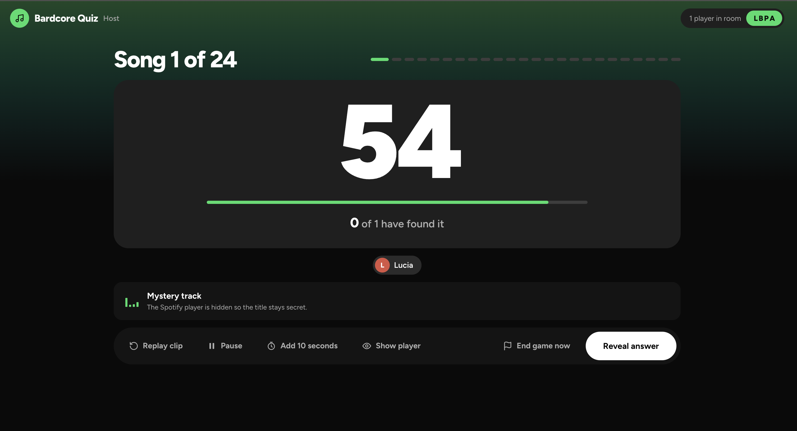
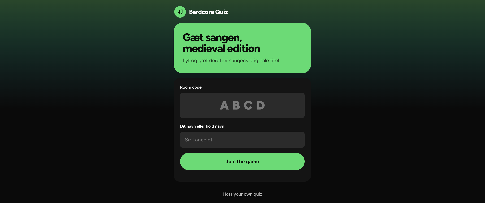
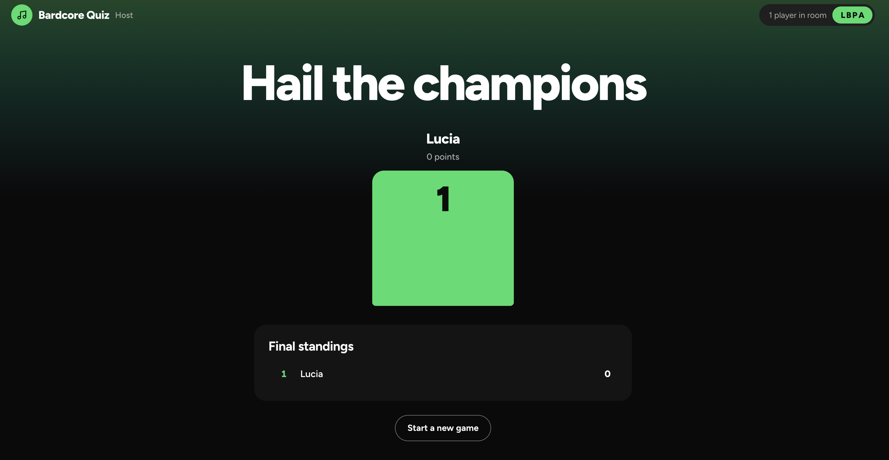

<div align="center">


<br><br>

[](https://bardcore-quiz.vercel.app)
[](https://bardcore-quiz.vercel.app/host)
[](https://github.com/Lucialululu/bardcore-quiz/commits/main)
[](https://github.com/Lucialululu/bardcore-quiz/stargazers)


</div>

---

This is a live music quiz for medieval ("bardcore") covers of modern songs. The host screen plays the cover from Spotify, and players type the original song's title on their phones, and near-misses get a "you are close" hint/ nudge without giving the answer away.

- **Host screen** (`/host`): set up songs and settings, show the room code + QR code, play each clip, reveal the answer and the scores.
- **Phones** (`/`): join with a 4-letter code and a name (or team name), then guess as many times as they like.

No build step, no server code: it is a static site. The live connection between phones and the host uses **Supabase Realtime** (free plan).

## Screenshots

<p align="center">
  
  <br>
  <sub><b>Host screen during a song.</b> Big countdown, who has found it, and the controls. The Spotify player stays hidden.</sub>
</p>

<table>
  <tr>
    <td width="50%" align="center">
      
      <br>
      <sub><b>Joining on a phone.</b> Room code and a name or team name.</sub>
    </td>
    <td width="50%" align="center">
      
      <br>
      <sub><b>Final results.</b> Podium and full standings.</sub>
    </td>
  </tr>
</table>

---

## How a game works

1. **Setup**: paste Spotify links to the covers. For each one, enter the **original song title** (the answer), the original artist, any alternative answers, and the second the clip should start at. Choose the time per song and the other settings.
2. **Lobby**: the big screen shows the join address, a QR code and the room code. Players appear as they join. Click a name to remove a player.
3. **Each song**: the clip plays while the Spotify player stays hidden, so the title isn't shown. Players type guesses with unlimited tries:
   - **Correct**: small typos, capital letters, punctuation and a leading "The" are all forgiven. 400–1000 points, and faster answers earn more.
   - **So close!**: the guess is near the answer (a misspelling, or part of the title). The answer itself is never shown.
   - **Artist bonus** (optional): +300 for the original artist.
4. **Reveal**: when time runs out (or you press **Reveal answer**), the big screen shows the answer, who got it and how fast, points this round, and the leaderboard with ▲▼ moves. You press **Next song** when you're ready.
5. **Final**: a podium and the full standings.

Host controls during a song: **Replay clip**, **Pause**, **Add 10 seconds**, **Show player** (peek at the Spotify embed), **End game now** and **Reveal answer**.

> [!TIP]
> **End game now** (on the song and reveal screens) jumps straight to the podium with the points so far. Handy when time runs short.

### Settings

| Setting | What it does |
|---|---|
| Time per song | 10–120 seconds |
| Room code | Optional fixed 4-letter code. Leave empty for a random one |
| Artist bonus | Shows a second "original artist" box on phones (+300) |
| Reveal automatically | When time runs out, go straight to the reveal. Turn it off to show "Time's up!" and reveal yourself |
| End early | If everyone has found the answer (and the artist, if the bonus is on), end the song right away |
| Shuffle | Randomise the song order when the game starts |

Your song list is saved automatically in the host's browser as you type, and it survives reloads. **Export CSV** downloads the list as a spreadsheet file.

> [!WARNING]
> The saved song list lives **only in that browser on that computer**. It's gone in a private/incognito window, in another browser, or after clearing browsing data. Click **Export CSV** before switching computers, and now and then as a backup.

### Premade quizzes from a spreadsheet

Fill in a spreadsheet in Excel, Numbers or Google Sheets with these columns (or use [`quiz-template.csv`](quiz-template.csv), or the template link on the setup screen):

| Spotify link | Song title | Original artist | Also accept | Start at (seconds) |
|---|---|---|---|---|
| https://open.spotify.com/track/… | Bad Romance | Lady Gaga | Rah rah ah ah ah; Gaga oh la la | 0 |

Save it as CSV and click **Import CSV**. The songs are added after any you already have, so nothing is overwritten. Comma- and semicolon-separated files both work, and the header row is optional. Without a header, put the columns in the order above.

> [!NOTE]
> [`data.csv`](data.csv) is a ready-made 19-song quiz you can import straight away.

### Fixed room code

In **Game settings**, set a **Room code** (4 letters, e.g. `BARD`) to use the same code every game, so you can share it in advance or print it. Leave it empty to get a random code. If the host tab is refreshed mid-game, a **Resume** button brings the game back.

### Answer tips

- **Also accept** takes alternatives separated by `;` (or commas, if the cell is in quotes in a CSV), for example `Girls Just Wanna Have Fun; Girls Wanna Have Fun`.
- In **Original artist**, separate alternatives with `;` or `/`, for example `Major Lazer; DJ Snake; MØ`. Any one of them counts.
- Text in brackets is ignored on both sides, so `Old Town Road (feat. Billy Ray Cyrus)` accepts `old town road`.

> [!TIP]
> You don't need to add variations for capitals, apostrophes, accents, `&` vs `and`, or a leading "The". `hips dont lie`, `HIPS DON'T LIE` and `Hips Don't Lie` already all count. Only add real alternatives, like `Wanna` for `Want to`.

---

## Setup (about 10 minutes, once)

### 1. Supabase (the live connection)

1. Create a free account at [supabase.com](https://supabase.com) and click **New project**. Any name and password will do. Pick the region closest to you, e.g. *Central EU (Frankfurt)*.
2. Open **Project Settings → API** (in newer dashboards, **Project Settings → API Keys** and **Data API**) and copy:
   - the **Project URL** (`https://xxxx.supabase.co`)
   - the **anon / public** key (the long `eyJ…` string, or the `sb_publishable_…` key)
3. Paste them into [`js/config.js`](js/config.js):

   ```js
   export const SUPABASE_URL = 'https://xxxx.supabase.co';
   export const SUPABASE_ANON_KEY = 'eyJhbGciOi…';
   ```

   The anon key is designed to be public, so it's fine to commit it.
4. You don't need any database tables. The quiz only uses Realtime *broadcast* messages. If you ever changed it: under **Realtime → Settings**, "Allow public access" must be **on**.

> [!CAUTION]
> Only ever paste the **anon / publishable** key. **Never** commit the `service_role` or `sb_secret_…` key. It gives full access to your Supabase project, and this repo is public.

> [!NOTE]
> Until `config.js` is filled in, the app runs in **demo mode**, where it only works between tabs in one browser. That's handy for trying it out.

### 2. Vercel (hosting)

1. Go to [vercel.com](https://vercel.com), sign in with GitHub, and click **Add New → Project**.
2. Import `bardcore-quiz`. Framework preset: **Other**. Leave the build settings empty, then click **Deploy**.
3. You'll get an address like `bardcore-quiz.vercel.app`:
   - Host screen: `https://bardcore-quiz.vercel.app/host`
   - Players: `https://bardcore-quiz.vercel.app` (or scan the QR code in the lobby)

Every push to `main` redeploys automatically.

### 3. Spotify

There's no Spotify developer account or API key to set up. The app uses Spotify's public embed player.

> [!IMPORTANT]
> **Log in to Spotify in the browser you host from** (open open.spotify.com once). Logged in, full songs play. Logged out, Spotify usually only plays a 30-second preview, so keep **Start at** within the first 30 seconds.

- Some browsers block autoplay the first time. If a song doesn't start, the app shows the player. Press ▶ once and it works from then on.

> [!WARNING]
> Ad blockers can block the Spotify player. If it won't load, turn the ad blocker off for your quiz site.

---

## Running locally

```bash
python3 -m http.server 8000
# host:   http://localhost:8000/host.html
# player: http://localhost:8000/   (another tab, in demo mode)
```

Tests for answer matching and CSV import:

```bash
node tests/match.test.mjs
node tests/csv.test.mjs
```

## Files

```
index.html          phone / player page
host.html           host screen
css/style.css       styling (Spotify-style dark theme)
js/config.js        ← your Supabase URL + key
js/host.js          game logic (the host is the referee: answers never leave the host screen until the reveal)
js/play.js          phone logic
js/match.js         fuzzy answer matching ("correct" / "close" / "wrong")
js/csv.js           CSV import / export
js/net.js           Supabase Realtime broadcast (or BroadcastChannel in demo mode)
js/spotify.js       Spotify embed controller
data.csv            example quiz (19 songs)
quiz-template.csv   empty template for your own quiz
images/             banner and screenshots for this README
```
